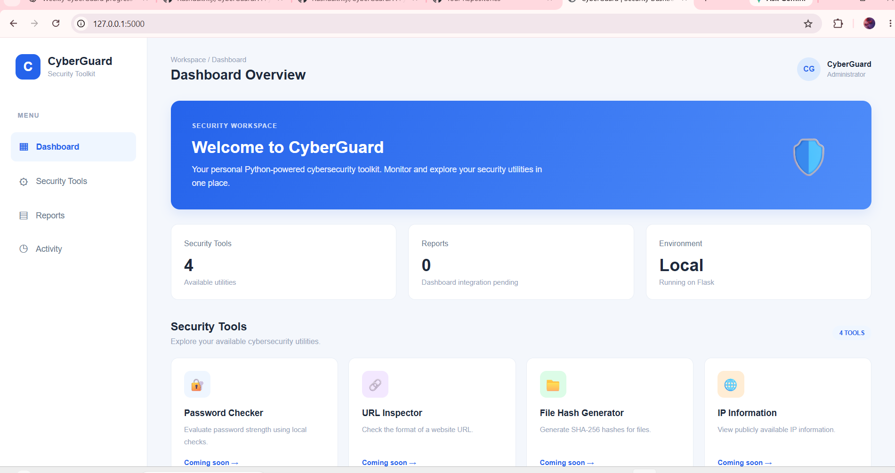

# 🛡️ CyberGuard – Python Cybersecurity Toolkit

CyberGuard is a Python-based cybersecurity toolkit designed to provide users with simple security utilities through both a command-line interface and a Flask-based web interface.

The project brings together multiple security-related tools in one application, with a clean and user-friendly interface.

## ✨ Features

- **Password Strength Checker:** Evaluates password strength.
- **URL Format Inspector:** Checks URL formatting.
- **File Hash Generator:** Generates file hashes.
- **IP Information Lookup:** Retrieves IP-related information using an external API.
- **Security Report Generator:** Generates security reports in JSON format.
- **Report Viewer:** Allows users to view the latest report and report history.
- **Web Interface:** Provides a browser-based interface built with Flask.
- **Command-Line Interface:** Offers a menu-driven terminal experience.

## 🛠️ Technologies Used

- Python
- Flask
- HTML
- CSS
- Requests
- Colorama
- REST API
- JSON

## 📁 Project Structure

```text
CyberGuard/
│
├── modules/
│   ├── file_hash.py
│   ├── ip_lookup.py
│   ├── password_checker.py
│   ├── report_generator.py
│   ├── report_viewer.py
│   └── url_checker.py
│
├── static/
│   └── css/
│       └── style.css
│
├── templates/
│   └── index.html
│
├── reports/
├── app.py
├── main.py
├── requirements.txt
├── sample.txt
└── README.md
```

## ⚙️ Installation and Setup

### 1. Clone the repository

```bash
git clone https://github.com/Rushdakhilji/CyberGuard.git
```

### 2. Navigate to the project directory

```bash
cd CyberGuard
```

### 3. Create a virtual environment

```bash
python -m venv .venv
```

### 4. Activate the virtual environment

Windows PowerShell:

```powershell
.venv\Scripts\Activate.ps1
```

### 5. Install dependencies

```bash
pip install -r requirements.txt
```

## ▶️ Running the Application

### Web Interface

```bash
python app.py
```

Open your browser and visit:

```text
http://127.0.0.1:5000
```

### Command-Line Interface

```bash
python main.py
```

## 🔐 Project Purpose

CyberGuard was developed as a hands-on Python project to explore cybersecurity fundamentals, API integration, file handling, hashing, and web application development.

## 👩‍💻 Author

**Rushda Khilji**

- GitHub: [Rushdakhilji](https://github.com/Rushdakhilji)

---

⭐ If you find this project interesting, feel free to explore the repository!

## 🖥️ Application Preview

### CyberGuard Dashboard



The dashboard provides a centralized interface for navigating CyberGuard's security utilities and reports.

